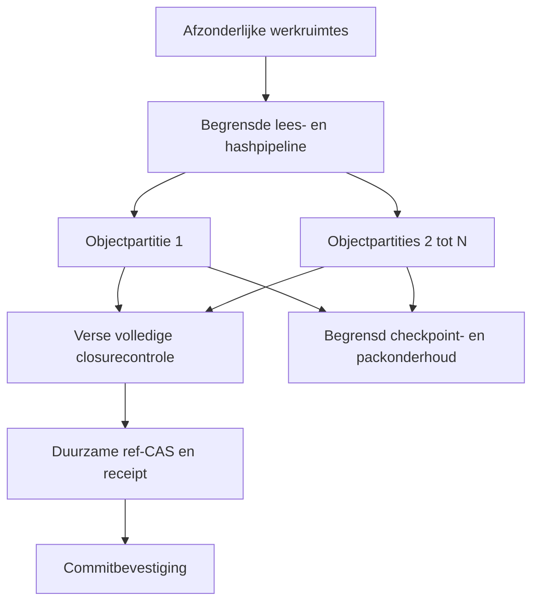

# Voorstel: actieve werkset in RAM, duurzaam schrijven in fases

**Status:** onderzocht voorstel; de nieuwe scheduler, gedeelde geheugenlimiet en achtergrondcheckpointer zijn nog niet geïmplementeerd.

**Codebasis:** `464651d17e4b7d126db8d8a2b5dd97a27c930ed2` (#110), boom `b6f4566ebb5e18367142e3a49dfd120cf9cceff9`. Zes exacte-head controles en alle vijf resulterende main-controles zijn groen. Dit certificeert de bestaande wijziging, niet het hieronder voorgestelde ontwerp.

## Advies

Laat berekening en de actieve immutable werkset zoveel mogelijk in begrensd RAM plaatsvinden. Bundel duurzame objectschrijfacties, bevestig een commit nadat zijn objecten én reftransactie duurzaam zijn, en verplaats checkpoints en latere packopbouw naar een beheerde achtergrondfase. Dit past bij de eerdere afspraken over native objecten, sparse werkruimtes, onafhankelijke refs, herstel en nul verloren bevestigde commits.

Een grote repository, alle historische versies en alle werkruimtes tegelijk in RAM laden past niet bij de bestaande schaalplannen. De werkset wordt op aanvraag geladen en gedeeld waar de inhoud immutable is; HEAD, staging, conflicten en autorisatie blijven per werkruimte/repository geïsoleerd. Geheugen is een versneller; een bevestigde commit blijft na herstart uit duurzame opslag reconstrueerbaar.

## Wat bestaat al?

| Onderdeel | Huidige code | Betekenis voor dit voorstel |
|---|---|---|
| RAM vóór schrijven | `ObjectPublisher` in `crates/loom-core/src/store.rs` | Verzamelt maximaal 128 objecten of 8 MiB per venster; één groter v1-object kan afzonderlijk worden verwerkt. Dit is geen totale proceslimiet. |
| Objectpublicatie | `crates/loom-core/src/sqlite_object_storage.rs` | Eén atomische transactie per venster, WAL/FULL, conditionele creatie, validatie en verse live readback. |
| Read caching | `crates/loom-core/src/snapshot.rs` | Revision-gepinde object-/padcache met instelbaar budget tot 256 MiB per Snapshot. Caller-Arcs en andere buffers vallen buiten dat budget. |
| Langlevende queries | `ObjectReadSession`, `query --batch`, read-packs | Verbindings-/statementhergebruik en geverifieerde immutable antwoorden; geen publicatie-, herstel- of fsck-authoriteit. |
| Duurzaam commitpunt | `save_ref_cas_with_tree`, `publish_staged_commit` in `repository.rs` | Eerst volledige live objectclosure; daarna ref-CAS en bij staged commits index/stagingwijzigingen in dezelfde metadata-transactie. |
| Herstel | Workspace-journal en SQLite WAL | Er zijn herstelmechanismen, maar geen volledige certificering voor stroomuitval of 500 gelijktijdige agents. |
| Volledig geheugenbackend | `crates/loom-core/src/memory_storage.rs` | Expliciet tijdelijk, `durable_writes=false`; deze vlag mag niet worden omgezet om ongeschreven commits te kunnen bevestigen. |

De eerdere plannen in `implementation-contracts.md`, `senior-architecture-gates.md`, `storage-backends.md`, `roadmap.md` en `scion-architecture-review.md` blijven leidend. Oude architectuurreviews beschrijven historische achterstanden; gebruik de broncode hierboven voor de huidige implementatiestatus.

## De voorgestelde commitfasen

| Fase | Werk | Duurzame toestand | Antwoord aan de cliënt |
|---|---|---|---|
| 1. Voorbereiden | Geselecteerde bestanden lezen, hashen, canonieke objecten/trees bouwen, dedupliceren in begrensde buffers | Nieuwe objecten kunnen nog alleen in RAM staan | Hoogstens voortgang; nog geen geslaagde commit |
| 2. Objecten vastleggen | Vensters via de provider schrijven; SQLite WAL/FULL commit; daarna verse live verificatie van bytes, type en volledige closure | Alle vereiste objecten staan duurzaam bij alle vereiste kopieën | Commit blijft in behandeling |
| 3. Ref publiceren | Verwachte oude ref vergelijken; ref, tree-root en bijbehorende metadata atomair vastleggen; voorgestelde operation-receipt in dezelfde metadata-transactie | Objecten én nieuwe ref zijn duurzaam | Nu pas `committed` bevestigen |
| 4. Onderhoud | WAL naar database checkpointen; later geverifieerde packs, afgeleide indices en compaction opbouwen | Bestaande bevestiging blijft geldig | Geen tweede commitbevestiging nodig |

SQLite maakt het onderscheid tussen een WAL-commit en een later databasecheckpoint al. Daarom moet Loom in de eerste iteratie geen eigen tweede WAL introduceren. Het voorstel is bestaande duurzaamheid efficiënter te plannen, met FULL behouden. Objectdatabase en metadata/refdatabase zijn afzonderlijke databases: hun commits vormen geen gezamenlijke atomaire SQLite-transactie. De volgorde **duurzame objecten → live closure → duurzame ref-CAS → bevestiging** blijft vereist.

Een toekomstige group commit kan meerdere objectaanvragen samen duurzaam maken. Dat betekent niet dat alle werkruimtes één stagingindex krijgen of dat meerdere onafhankelijke refdatabases ineens één synchronisatie delen. Refconcurrentie en conflicten blijven per autoritatieve ref afgehandeld.

## Geheugen en proceslevensduur

1. Introduceer een gedeeld budget voor beheerde write buffers, readback, objectcache en werkruimtequota. Reserveer geheugen voordat werk wordt aangenomen; neem ook producerbuffers, queues en verwerking in vlucht mee. Bij druk wacht de producent, worden schone caches uitgezet of neemt het aantal workers af. Onbevestigde data wordt nooit weggegooid om plaats te maken.
2. Scheid schone, opnieuw opvraagbare objecten van nog niet duurzaam geschreven buffers. Deel canonieke immutable inhoud op object-ID; pin roots voor actieve operaties. Mutable HEAD/staging en rechten worden niet als gedeelde objectcache behandeld.
3. Houd grote portable bestanden in chunks/streams. Het bestaande v1-pad voor één groot object vereist een expliciete reservering inclusief verificatiekopieën of een duidelijke quota-fout. Alleen de huidige 8-MiB-venstergrens optellen is onvoldoende om piek-RAM te begrenzen.
4. Een CLI-proces verliest zijn RAM-cache wanneer het eindigt. Werksethergebruik tussen commando's vraagt een optionele lokale dienst of een bestaande langlevende batchsessie. Offline ingebed gebruik en de directe CLI blijven beschikbaar; een nieuwe daemon wordt geen verplichte netwerkafhankelijkheid.
5. De cachelimiet is geen totale RSS-limiet: SQLite/pagecache, allocator, stack, caller-retained Arcs en OS-cache moeten apart worden gemeten. Een procesbreed budget is pas bewezen na die metingen en fouttests.

Als meetwaarden onderzoeken we cachebudgetten 0/64/256 MiB, gedeelde write-bufferlimieten 8/32/128 MiB en workers 1/2/4/8, met lagere concurrency wanneer het budget dit vereist. Dit zijn kandidaatinstellingen voor experimenten, geen gekozen productdefaults.

## Schrijven en checkpointen

De huidige SQLite-provider opent schrijfverbindingen per publicatievenster. Te onderzoeken eerste stap: een begrensde writer met een langer levende verbinding per objectdatabase. Valideer objecten vóór enqueue; behoud FULL en de atomische bestaande vensters. Verse verificatieverbindingen blijven onafhankelijk van die writer en van immutable lees caches. Verwijderen/vervangen van een database moet een fout of expliciete heropening opleveren, geen bevestiging uit een oud open bestand.

Een langer levende verbinding kan laatste-verbinding-close/checkpointwerk tussen vensters vermijden. Dit is een codegebaseerde prestatiehypothese, nog geen meting. Meet eerst hoeveel verbinding openen, statements voorbereiden, WAL-sync en checkpoints afzonderlijk kosten. SQLites laatste verbinding sluiten kan juist een checkpoint uitvoeren; alleen een achtergrondthread toevoegen aan een kort CLI-proces lost die levensduur niet op.

Daarna kan een scheduler vensters sluiten bij een byte-/objectgrens, expliciete commitbarrière, maximale wachttijd of shutdown. Vergelijk wachttijden 0/0,5/2 ms onder dezelfde duurzame bevestigingsvoorwaarden. Eén losse gebruiker hoort niet onnodig op groepsvorming te wachten. Een volle queue levert backpressure; disk-full, synchronisatiefouten en corrupte bestaande objecten leveren een fout en geen succesvolle receipt.

Checkpoint pas gecontroleerd op WAL-omvang, aantal niet-gecheckpointte pagina's en leestransacties. Begin met PASSIVE-onderhoud, behoud een bovengrens voor achterstand/WAL-omvang en rem schrijvers als onderhoud niet bijhoudt. Langlevende leestransacties kunnen checkpoints blokkeren. `synchronous=NORMAL/OFF`, handmatig WAL-bestanden verwijderen en onbeperkt checkpointuitstel horen niet bij dit ontwerp.

De huidige read-pack is een afgeleide cache. Hem tot duurzame pack-opslag promoveren vereist eerst een expliciet formaat, verificatie, atomische indexpublicatie, pins/retentie, crashherstel en veilige GC. Achtergrondcompaction mag nooit de enige leesbare oude kopie verwijderen voordat de nieuwe volledig duurzaam en bereikbaar is.

## Aanvulling: de datalaag breder maken

Met **breder** bedoelt dit voorstel meerdere gelijktijdige datapaden en opslagpartities. Dat is geschikt voor Loom, vooral bij onafhankelijke bestanden, mappen en werkruimtes. De gewenste breedte is adaptief: een kleine wijziging blijft op een goedkoop pad; voldoende onafhankelijk werk benut meer workers en partities.

| Laag | Huidig aanknopingspunt of knelpunt | Voorgestelde verbreding |
|---|---|---|
| Lezen en hashen | Begrensde workers bestaan; voorbereiding kost CPU en I/O | Geselecteerde bestanden parallel lezen/hashen in een pipeline, met een gezamenlijk bytebudget en behoud van canonieke sorteervolgorde. |
| Immutable SQL-reads | Eén retained session gebruikt één verbinding achter een Mutex | Een kleine, lui geopende leespool voor onafhankelijke immutable misses; eigen prepared statement per verbinding. Verse publicatie-/fsck-controles blijven apart. |
| Objectschrijven | Eén SQLite-objectdatabase laat één schrijver tegelijk toe | `ShardedObjectBackend` als afzonderlijk voorstel: verdeel objecten op stabiele bits van hun object-ID over 1/2/4/8 onafhankelijke databases en schrijf per partitie in batches. |
| Werkruimtes | Eigen mutable metadata; gedeelde immutable opslag mogelijk | Per-workspace queues/quota, gedeelde geverifieerde objectcache en fairness; geen gedeelde staging of globale worktree-lock voor verschillende werkruimtes. |
| Refauthoriteit | Lineaire CAS per ref blijft nodig | Parallel voorbereiden en onafhankelijke refs behandelen; schaal autoriteit eventueel per repository. Eén branch krijgt geen concurrerende ongecoördineerde waarheden. |
| Onderhoud | Flush, checkpoint en toekomstige compaction gebruiken dezelfde hardware | Aparte begrensde onderhoudsbudgetten, met voorrang voor duurzaam publiceren en remmen bij achterstand. |

Objectidentiteit blijft onafhankelijk van partitie, pad, compressie of cache: hetzelfde canonieke object houdt hetzelfde BLAKE3-ID. De plaatsingsconfiguratie moet stabiel en duurzaam zijn. Meer partities toevoegen mag niet alle bestaande objecten via een nieuwe modulo-regel onvindbaar maken. Herverdeling vraagt gecontroleerd kopiëren, verifiëren, een gepubliceerde placement-generatie en tijdelijk leesbare oude locaties met retentie/pins.

Een belangrijke codegrens: de bestaande `put_batch_if_absent`-opt-in belooft een volledig atomisch venster en rollback bij iedere fout. Onafhankelijke SQLite-databases bieden geen gezamenlijke transactie. Een shardbackend mag daarom niet ongemerkt gedeeltelijke shardcommits als een globale atomaire batch implementeren. Een eerste adapter kan de opt-in weigeren en het bestaande scalar-pad behouden; echte winst vraagt daarna een expliciete partition-aware publicatie-API met atomaire batches **per partitie** en duidelijk gedocumenteerde gedeeltelijke objectpublicatie. De logische gebruikerscommit blijft atomair via de uiteindelijke ref-CAS. Falen van één vereiste partitie betekent geen nieuwe refbevestiging; eerder geschreven ongepubliceerde objecten blijven veilig herbruikbaar voor retry.

Verse batchreads moeten hun invoervolgorde, duplicaten en **gezamenlijke** bytebudget over alle partities behouden. `list_ids` moet alle partities volledig omvatten en falen wanneer een vereiste partitie ontbreekt. Partities verdelen verschillende objecten; replica's bewaren meerdere vereiste kopieën van hetzelfde object. Het bestaande all-required-copies contract blijft bovenop de partitionering gelden.

Meer verbindingen naar dezelfde SQLite-database geven geen extra gelijktijdige schrijvers. Meer databases op dezelfde SSD geven evenmin automatisch meer fysieke bandbreedte; ze kunnen lockcontentie verminderen en kosten ook meer WAL's, syncs en metadata. Onafhankelijke schijven/nodes kunnen extra capaciteit leveren, maar dat is een te meten hypothese inclusief CPU-, geheugen-, netwerk- en tail-latencykosten. Begin daarom met een pool en een 1-versus-2/4/8-partitie-experiment, niet met een vast hoog shard-aantal.

**Vergelijking:** houd bronbytes, aantallen duurzame commits, refs/CAS, replica-eisen, caches en workers gelijk. Meet eerst dezelfde schijf om softwarecontentie te isoleren, en daarna pas afzonderlijke schijven/nodes als aparte configuratie. Neem scheve/hot-objectbelasting, één trage partitie, uitval, herverdeling en kleine wijzigingen mee. Selecteer extra breedte alleen bij aantoonbare throughput- of latencywinst binnen het geheugen- en herstelbudget.

## Opslagkeuze is vrij: kandidaten en voorkeursvolgorde

De gebruiker heeft expliciet ruimte gegeven voor een ander opslagtype. De bestaande `ObjectBackend`-grens maakt een alternatief mogelijk zonder de canonieke objectschema's te vervangen. We kiezen objectopslag en ref/stagingtransacties afzonderlijk; één engine hoeft niet beide rollen optimaal te vervullen.

| Kandidaat voor objecten | Waarom onderzoeken | Ontwerp-/meetgrens | Advies |
|---|---|---|---|
| Gefixte SQLite WAL, langer levende writer en eventueel partities | Bestaande adapter en foutsemantiek; weinig nieuwe integratie | Eén schrijver per database; verbindingen, checkpoints en per-object checks kunnen domineren | Noodzakelijke betrouwbare referentie en eerste kleine optimalisatie. |
| RocksDB, eventueel geïntegreerde BlobDB | Memtables, WAL, batchwrites en latere flush/compaction passen bij actieve data in RAM en gefaseerd diskwerk | Duurzame sync expliciet aan; één process-owner per database; onderhoud en grote waarden kosten extra werk | Eerste alternatieve-engine-prototype, nog geen gekozen winnaar. |
| Native append-only segmenten met begrensde index/cache | Sluit aan bij immutable BLAKE3-objecten en de bestaande read-packervaring; segmenten kunnen sequentieel en per shard worden geschreven | Nieuw durability/catalog-/herstel-/GC-formaat vereist; de huidige read-pack is uitsluitend cache | Strategische kandidaat na herstelharnas; vergelijk met RocksDB voordat een eigen engine wordt gebouwd. |
| redb | Embedded transactionele key/value-opslag in Rust; mogelijke kleinere integratieoppervlakte | Conditional-create, schrijversmodel, grote-objectgedrag, backup, Rust 1.85 en platformondersteuning moeten voor Loom worden bewezen | Aanvullende compacte Rust-kandidaat; geen automatische schaalwinst veronderstellen. |

Voor refs, staging en receipts blijft gepatchte SQLite voorlopig de lokale referentie. Een serverautoriteit kan later een transactionele engine zoals PostgreSQL krijgen, met dezelfde lineaire CAS-eisen; dat is een aparte distributed-/protocolstap. Objecten op objectstorage, lokale NVMe en geheugen zijn verschillende tiers met eigen latency en failuregedrag, geen onderling identieke performanceclaims.

### Doorslaggevende adaptervoorwaarden

- **RocksDB is geen ongewijzigde multi-CLI drop-in.** De primaire documentatie beschrijft één process-owner per database en gedeeld gebruik door threads binnen dat proces. Gelijktijdige Loom-CLI's vragen dus een eigenaar/dienst of expliciet ander toegangsmodel. Vergelijk voor een zuivere enginefactor beide kandidaten in hetzelfde procesmodel; vergelijk daarnaast directe CLI versus dienst als afzonderlijke productworkload, inclusief koude start/herstel.
- RocksDB gebruikt standaard asynchrone writes. Een Loom-adapter moet `sync=true` gebruiken en WAL ingeschakeld houden. Een teruggekeerde Put of een RAM-/blockcachehit bewijst op zichzelf niet de vereiste verse objectaanwezigheid. Het bestaande live-readback-, closure- en fsck-contract moet expliciet via duurzame opslag worden aangetoond, ook bij verwijderd/vervangen/corrupt backing storage. Als dit alleen met dure heropening of aanvullende verificatie lukt, hoort die kost in de benchmark.
- `WriteBatch`-atomiciteit vervangt Looms **conditionele creatie** niet. Een adapter moet bestaande corrupte of afwijkende bytes weigeren en concurrente writers correct serialiseren/transacties gebruiken; een losse Get gevolgd door overschrijvende Put voldoet niet. Canonieke ID-, type-, lengte-, rollback-, retry- en replica-tests gelden voor elke kandidaat.
- RocksDB column families delen een WAL; extra families zijn niet automatisch onafhankelijke diskshards. Voor grote waarden is uitsluitend de geïntegreerde BlobDB kandidaat; de oude legacy-variant met zwakkere/andere mogelijkheden is uitgesloten. Blobscheiding kan compactionkopieën verminderen en voegt eigen GC/ruimtegebruik toe.
- Een native segmentstore moet vóór bevestiging recordbytes én de noodzakelijke segment-/catalogpublicatie duurzaam maken. Een index mag alleen rebuildable zijn als de vereiste objectrecords na verlies van de index opnieuw eenduidig vindbaar zijn. Een dirty tail, dubbel record, corrupte bestaande ID, segmentrotatie en directorysync vereisen expliciete herstelregels en platformtests.
- Een backendwissel is een gecontroleerde objectmigratie: volledige bronclosure lezen, naar een nieuwe bestemming schrijven, canonieke IDs vergelijken, herstelbare backup verifiëren en pas dan binding/plaatsing gecontroleerd activeren. Geen stilzwijgende conversie van bestaande stores.

**Voorkeursvolgorde:** harden de bestaande basis, bouw een feature-gated RocksDB-prototype naast de bestaande providers, meet dat met gelijke duurzaamheidsvoorwaarden tegen de verbeterde SQLite-referentie, en beslis vervolgens of een native segmentstore of redb verder onderzoek verdient. Dit kiest een experiment, geen ongeteste productie-engine. Als een Rust 1.85-/platform- of live-verificatiegate faalt, schuift de kandidaat niet ongemerkt naar de standaard.

Meet bij RAM-plus-achtergrondopslag ook de onderhoudskosten tijdens langdurige belasting, volledige flush-/compactionachterstand, WAL/SST/blob/segment-pieken en tijd tot rustig afgewikkelde opslag. Alleen de snelle enqueue of de periode vóór een uitgestelde flush meten zou de diskrekening verbergen. Algemene KV-microbenchmarks zijn aanvullend; dezelfde volledige Loom-commits, queries, fsck, sparse werkruimtes, foutgevallen en Git-controls bepalen de keuze.

## Concrete voorwaarde uit het onderzoek

`Cargo.toml` gebruikt bundled rusqlite; de vastgelegde `libsqlite3-sys 0.35.0` bevat volgens de lokale amalgamation-header SQLite **3.50.2**, source-ID van 28 juni 2025. SQLite documenteert een WAL-reset race bij gelijktijdig schrijven/checkpointen en een fix in **3.51.3**, met bepaalde backports. Upgrade naar een aantoonbaar gefixte, ondersteunde bundel vóór extra checkpointconcurrency; valideer de werkelijk gekoppelde runtimeversie op alle platforms. Een groene Rust-advisory-audit is geen bewijs dat deze C-enginefix aanwezig is. Dit onderzoek heeft de dependency nog niet aangepast.

## Herstelgedrag dat bewezen moet worden

| Onderbreking | Vereist resultaat |
|---|---|
| Alleen voorbereid in RAM | Geen refwijziging en geen commitbevestiging; bestaande staging/werkbestanden blijven behouden. |
| Objecten duurzaam, ref nog niet gepubliceerd | Oude ref blijft geldig; ongepubliceerde objecten kunnen voor een veilige retry worden hergebruikt en later via retentie/GC worden opgeruimd. |
| Ref-CAS geslaagd, antwoord verloren | Retry vindt hetzelfde resultaat via een duurzame operation-ID/receipt; geen tweede commit door een nieuwe timestamp. Deze algemene receipt bestaat nog niet als commitprotocol en moet worden toegevoegd. |
| Bevestigd, databasecheckpoint nog niet klaar | Heropening/replay van de object-WAL en ref-WAL reconstrueert dezelfde bevestigde ref en volledige closure. |
| Disk-full, I/O-fout, OOM of writer-uitval | Geen foutieve bevestiging; reeds bevestigde commits blijven herstelbaar. Geheugenreserveringen komen vrij; onzekere uitkomsten blijven opvraagbaar. |
| Crash tijdens pack/indexvervanging of checkpoint | Een geverifieerde duurzame representatie blijft beschikbaar; geen voortijdige WAL-/segmentverwijdering. |
| Trage of ontbrekende verplichte replica | Bestaand all-required-copies contract blijft gelden; geen verborgen overgang naar een RAM-kopie of quorum. |

Operation-receipts horen in dezelfde autoritatieve metadata-transactie als ref-CAS en staging-clear, met een stabiele request-ID en payloadbinding. Ze zijn iets anders dan de bestaande portable migratiecheckpoint-receipt. Cachehits mogen geen live aanwezigheid bewijzen voor publicatie, closure, recovery of fsck. De memory-first uitbreiding levert op zichzelf ook geen multi-host failover, remote autorisatie of verified backup/restore.

## Uitvoeringsvoorstel en meetbeslissing

1. **P0:** gebundelde SQLite-fix en runtimeversiebewijs; crash/failpoint-harnas met onderscheid tussen proceskill en machine-/stroomuitval. Geen dataverliesclaim afleiden uit alleen unit tests.
2. **Eerste prestatie-PR:** langer levende begrensde SQLite-writer, behoud van vensters en verse live verificatie; fouttests voor verlies/vervanging, rollback, retry, staging en CAS. Profielmeting vóór/na tegen exacte huidige main.
3. **Tweede stap:** gedeelde geheugenreserveringen en backpressure over gelijktijdige operaties, plus zichtbare queue-, WAL- en checkpointmetingen. Daarna pas scheduler/group commit met operation-receipts en foutisolatie.
4. **Langere levensduur:** optionele lokale cache-/writerdienst voor meerdere CLI-cliënten, met eigen werkruimtes, veilige herstart en directe ingebedde fallback. Protocol/autorisatie blijven een expliciete afzonderlijke gate.
5. **Latere opslagfase:** duurzame packs/compaction en remote tiers pas na herstel-, retentie- en migratiecontracten. Issues #13 en #26 blijven leidend.

Benchmark kleine/grote wijzigingen, 64+ mappen, warme/koude/churnende werksets, 10k/100k/1M paden en 1/10/100/500 schrijvers in afzonderlijke werkruimtes. Vergelijk sequentieel/parallel en dezelfde Git-workflows met gevalideerde bytes en expliciete workerinstellingen. Meet end-to-end latency tot **duurzame bevestiging**, p50/p95/p99, commits/s, CPU, piek-RSS, syncs, geschreven bytes, WAL-piek, flushachterstand, cachehits en herstelduur. Neem standaardcache en cache=0 beide mee; bewaar verslechteringen. Zero lost acknowledged commits is een harde gate. 100× Git blijft een te bewijzen doel per benoemde workload, geen gevolgtrekking uit RAM-gebruik.

De directe vervolgbeslissing is daarom: **eerst de SQLite-basis harden en de bestaande fases efficiënter uitvoeren; geen volledige storage-engineherschrijving.**

## Bronnen

Broncode en projectplannen zijn hierboven expliciet aan de geïnspecteerde commit gekoppeld. Externe primaire documentatie, geraadpleegd op 18 oktober 2026:

- [SQLite WAL: commit, checkpoint, laatste verbinding, checkpoints en WAL-reset bug](https://sqlite.org/wal.html)
- [SQLite synchronous: FULL en NORMAL](https://sqlite.org/pragma.html#pragma_synchronous)
- [SQLite 3.51.3: WAL-reset fix](https://sqlite.org/releaselog/3_51_3.html)
- [RocksDB WAL: memtable plus duurzaam log](https://github.com/facebook/rocksdb/wiki/Write-Ahead-Log-(WAL))
- [RocksDB MemTable: begrensde buffers en latere flush](https://github.com/facebook/rocksdb/wiki/Memtable)

RocksDB is een referentie én voorgestelde prototypekandidaat, geen gekozen dependency of bewijs dat een LSM-engine Loom sneller maakt.

Aanvullende primaire bronnen voor opslagkeuze:

- [RocksDB Basic Operations: sync, WriteBatch en process-owner](https://github.com/facebook/rocksdb/wiki/Basic-Operations)
- [Geïntegreerde BlobDB en legacy-verschillen](https://github.com/facebook/rocksdb/wiki/BlobDB)
- [redb: transactionele embedded key/value-opslag in Rust](https://github.com/cberner/redb)
